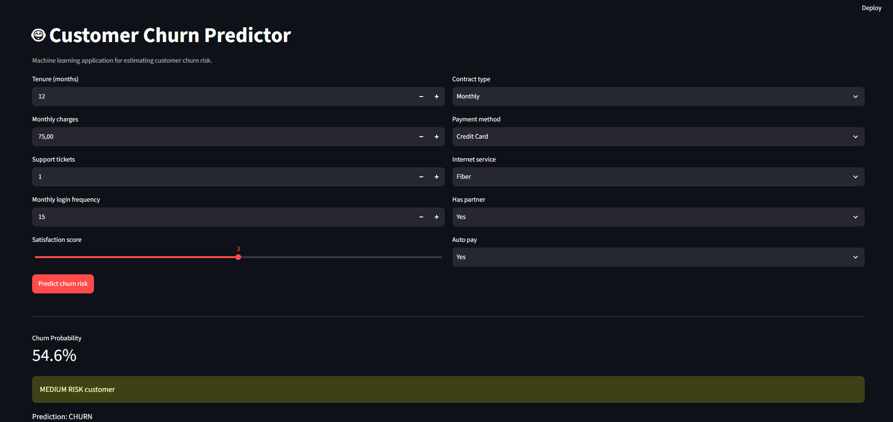
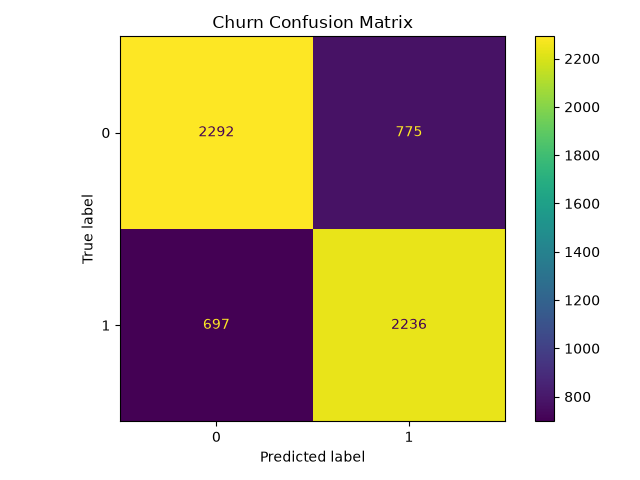
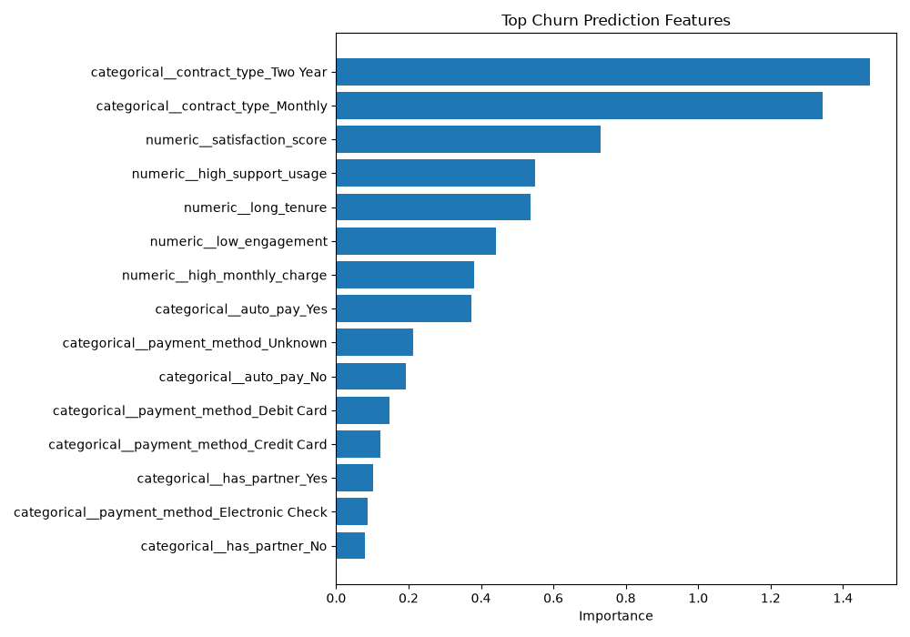
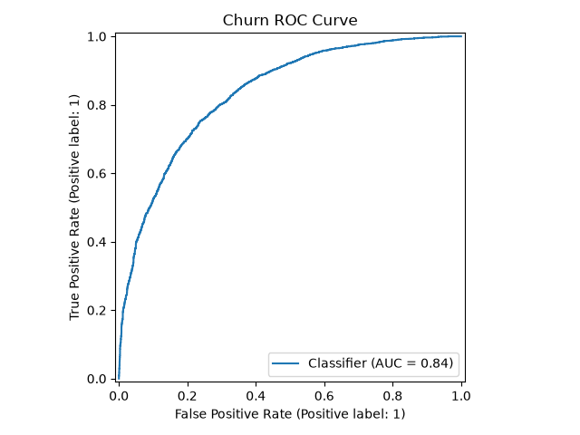

# Customer Churn Prediction

Machine learning project focused on predicting customer churn using supervised classification models.

The project covers the complete workflow from synthetic data generation and cleaning to feature engineering, model comparison, evaluation, model persistence, interpretation, and interactive prediction through Streamlit.

## Project Goals

This project demonstrates:

- Data preprocessing
- Data cleaning
- Feature engineering
- Classification
- Model comparison
- Train/test splitting
- Model evaluation
- Precision, recall, and F1-score
- ROC-AUC analysis
- Confusion matrices
- Feature importance
- Model persistence
- Interactive churn prediction
- Automated testing
- Reproducible machine learning workflows

## Technologies

### Machine Learning

- Python
- Pandas
- NumPy
- scikit-learn
- joblib

### Visualization

- Matplotlib
- Streamlit

### Testing & Development

- pytest
- Git
- GitHub

## Project Structure

```text
customer-churn-ml/
├── data/
│   ├── raw/
│   └── processed/
│
├── models/
│   └── churn_model.joblib
│
├── reports/
│   ├── confusion_matrix.png
│   ├── feature_importance.csv
│   ├── feature_importance.png
│   ├── MODEL_REPORT.md
│   └── roc_curve.png
│
├── src/
│   ├── clean_data.py
│   ├── evaluate_model.py
│   ├── explore_data.py
│   ├── feature_importance.py
│   ├── generate_dataset.py
│   ├── predict.py
│   └── train_model.py
│
├── tests/
├── app.py
├── README.md
├── requirements.txt
└── .gitignore
```

## Data Pipeline

The project uses a synthetic customer dataset designed for churn analysis.

The pipeline includes:

1. Dataset generation
2. Data cleaning
3. Feature engineering
4. Train/test split
5. Model training
6. Model comparison
7. Model evaluation
8. Model persistence
9. Interactive prediction

## Feature Engineering

Additional features are created to capture potentially relevant churn signals, including:

- High support usage
- Low engagement
- High monthly charges
- Long customer tenure

These engineered features help improve interpretability and modeling flexibility.

## Machine Learning Models

The project compares multiple classification models, including:

- Logistic Regression
- Random Forest

The final model is selected based on evaluation performance, with F1-score used as an important selection metric.

## Model Evaluation

The project evaluates model performance using:

- Accuracy
- Precision
- Recall
- F1-score
- ROC-AUC
- Classification report
- Confusion matrix
- ROC curve

## Model Interpretation

Feature importance is analyzed to understand which variables contribute most strongly to churn predictions.

The analysis is exported as:

```text
reports/feature_importance.csv
```

and visualized in:

```text
reports/feature_importance.png
```

## Model Persistence

The trained model is saved using joblib:

```text
models/churn_model.joblib
```

This allows the trained pipeline to be reused for predictions without retraining the model every time.

## Streamlit Application

The Streamlit interface allows users to enter customer information and receive:

- Churn probability
- Risk classification

Risk levels are presented as:

- LOW
- MEDIUM
- HIGH

Run the application with:

```bash
python -m streamlit run app.py
```

## Running the Project

Install dependencies:

```bash
python -m pip install -r requirements.txt
```

Run tests:

```bash
python -m pytest
```

Train the model:

```bash
python src/train_model.py
```

Evaluate the model:

```bash
python src/evaluate_model.py
```

Generate feature importance:

```bash
python src/feature_importance.py
```

## Reports

Additional model analysis is available in:

```text
reports/MODEL_REPORT.md
```

This report includes the model objective, evaluation results, business interpretation, and project limitations.

## Screenshots

### Churn Prediction Application



### Confusion Matrix



### Feature Importance



### ROC Curve



## Limitations

The project uses synthetic data for portfolio and learning purposes.

Results should not be interpreted as production-ready churn predictions for a real business without validation using real-world data.

## Future Improvements

Possible future improvements include:

- Hyperparameter tuning
- Cross-validation
- Additional classification models
- SHAP-based interpretability
- Model monitoring
- Cloud deployment
- Real-world customer datasets
- Automated retraining pipelines

## Project Status

Version 1.0.0 represents the first complete portfolio-ready release of the Customer Churn Prediction project.